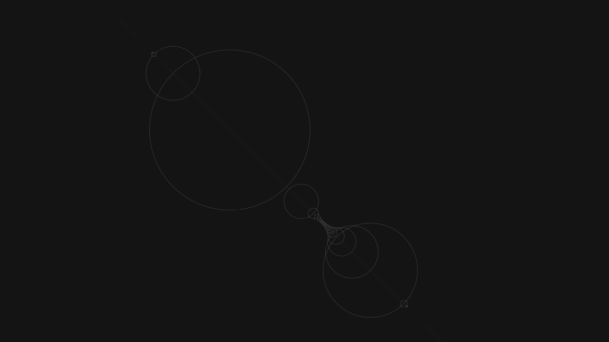
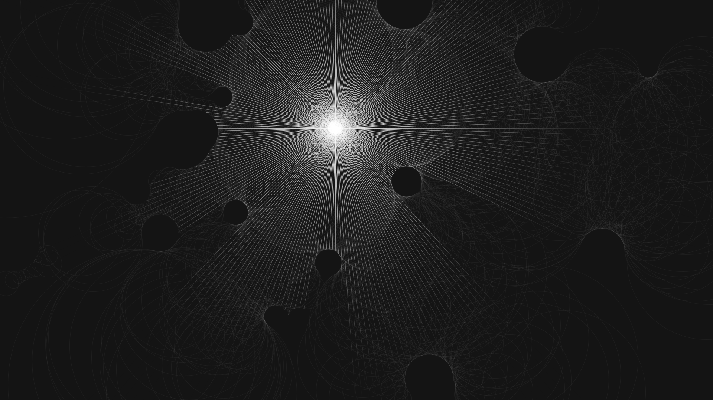
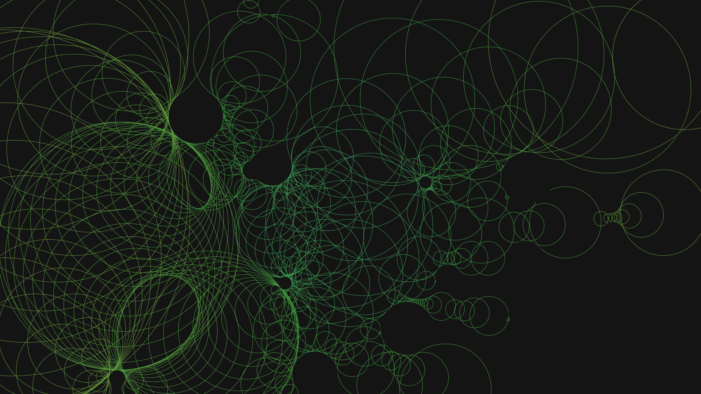

# Ray Marching Demo

A simple light simulation using the [ray marching](https://en.wikipedia.org/wiki/Ray_marching) algorithm.

# What is ray marching
Wikipedia explains it better then me. 

The general idea is: We want to cast a ray of light, and now where it hits an obstacle.
Instead of sampeling each point along the ray (of which there are many), we calculate the distance to all obstacles in the scene. The smallest distance gives us a circle which must be free of objects. Therefore we can skip this distance along the ray, and start calculating the distances again at that next point. 

This screenshot shows a single ray, and the circles calculated along the way. 
As you can see, there is an area with a bunch of tiny circles next to each other. This means, the ray is very close to an obstacle. In fact you can just slightly make out the shape of a black circle.
# Screenshot
Next to demonstrating the concept pretty good, the demo is also capable of making quite beautiful images.

